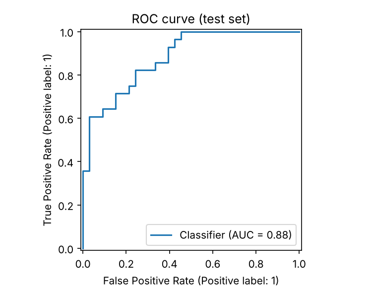
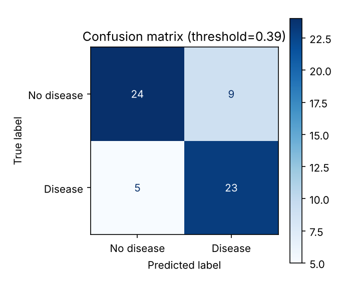
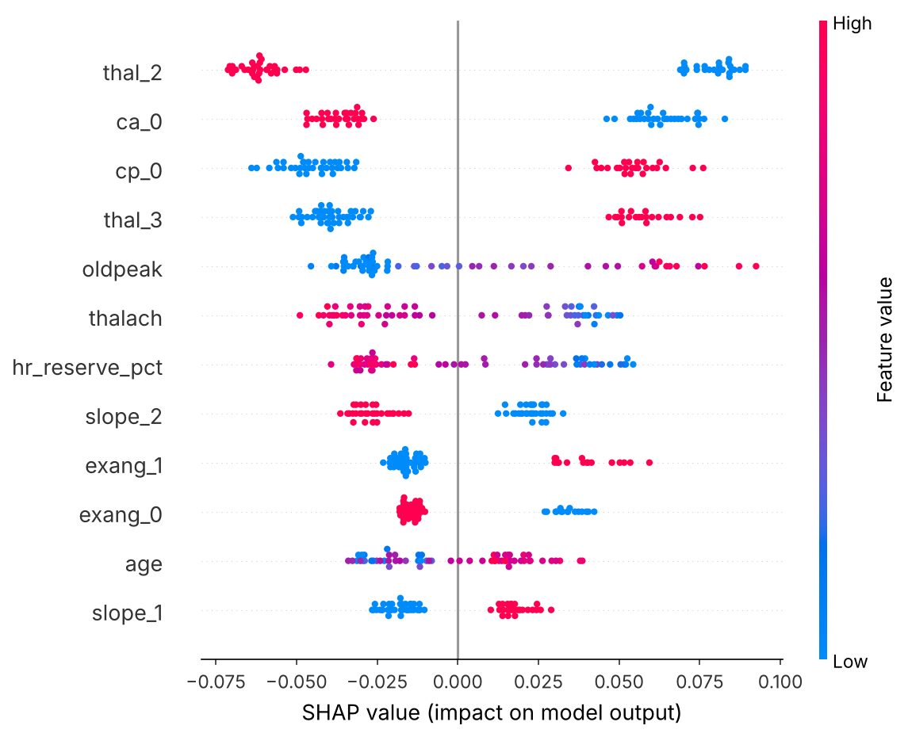

# Heart Disease Risk Prediction (Classical ML, MlFlow, end to end)

🫀 Heart Disease Risk Prediction

An end-to-end classical machine learning project: from raw clinical data to a tracked, tested and deployable risk-screening service.

Show Image Show Image Show Image Show Image Show Image Show Image Show Image Show Image

Screening-support project built on a public dataset. It is not a medical diagnosis tool.

📌 Business Problem

Clinicians need a fast way to flag patients who should receive earlier follow-up for heart disease. In screening, missing a sick patient is far costlier than a false alarm, so this project optimizes for recall and tunes the decision threshold for that goal instead of using the default 0.5.

Business impact: faster risk assessment, consistent clinical decision support, and earlier intervention for high-risk patients.

✨ Highlights
Compared 4 algorithms (Logistic Regression, Random Forest, XGBoost, LightGBM) with stratified 5-fold cross-validation and hyperparameter tuning.
Recall-oriented threshold tuning chosen on out-of-fold predictions, so the test set is never used to pick it.
Explainable AI: SHAP identifies which clinical features drive the model's risk predictions.
Reproducible pipeline: feature engineering, scaling and encoding live inside one scikit-learn Pipeline, so training and serving use identical transformations.
MLOps: MLflow experiment tracking and Model Registry, FastAPI service, Streamlit UI, Docker, Jenkins CI/CD, and automated tests.
Found and fixed a data quality issue (see Data): the target label in the public CSV is inverted.
🏗️ Architecture
Raw dataheart.csv
Load, validateand clean
Stratifiedtrain / test split
Feature pipelineengineering + scaling +encoding
Model trainingLogReg · RandomForest ·XGBoost · LightGBM
GridSearchCV5-fold stratified, ROC-AUC
Select best model+ recall-tuned threshold
Evaluationmetrics · ROC/PR ·confusion matrix · SHAP
MLflowtracking + registry
Saved modeljoblib bundle
FastAPI/predict
Streamlitweb UI
Docker
JenkinsCI/CD
Training flow
Stage	What happens	Code
1. Ingest	Load CSV, correct the inverted label, validate schema, drop duplicates	src/data_preprocessing.py
2. Split	Stratified 80/20 split keeps the class balance in both sets	src/data_preprocessing.py
3. Features	Engineered hr_reserve_pct (max heart rate ÷ age-predicted max), standard scaling, one-hot encoding	src/feature_engineering.py
4. Train	Grid search over 4 algorithms with 5-fold stratified CV	src/train.py
5. Threshold	Pick the highest threshold that still reaches 90% recall on out-of-fold predictions	src/train.py
6. Evaluate	Held-out metrics, ROC/PR curves, confusion matrix, SHAP	src/evaluate.py
7. Track	Log params, metrics, artifacts and the model to MLflow, then register it	src/train.py
8. Serve	REST API and Streamlit app load the same saved pipeline	app/
📊 Data

UCI Heart Disease (Cleveland): 303 patients, 13 clinical features, no missing values, 1 duplicate row (removed).

Feature	Description
age, sex	Age in years, sex
cp	Chest pain type (0-3)
trestbps	Resting blood pressure (mm Hg)
chol	Serum cholesterol (mg/dl)
fbs	Fasting blood sugar > 120 mg/dl
restecg	Resting ECG result (0-2)
thalach	Maximum heart rate achieved
exang	Exercise-induced angina
oldpeak	ST depression induced by exercise
slope, ca, thal	ST slope, major vessels coloured, thalassemia result

The full dataset, data dictionary, model comparison and predictions are in data/heart_disease_data.xlsx.

Data quality finding: in the public CSV copy used here, the target column is inverted (1 = no disease). I confirmed this from the data: rows with target = 1 have higher maximum heart rate, lower ST depression and no exercise angina. The loader flips it so that 1 = disease present. Without this fix, every risk score would be reversed.

🎯 Results

Evaluated on a held-out test set of 61 patients.

Model	CV ROC-AUC	Test ROC-AUC	Test Recall (@0.5)
Random Forest (selected by CV)	0.919	0.882	0.714
Logistic Regression	0.914	0.919	0.786
XGBoost	0.904	0.920	0.714
LightGBM	0.899	0.912	0.750

Selected model with the recall-tuned threshold (0.39):

Recall	Precision	F1	ROC-AUC	PR-AUC
0.82	0.72	0.77	0.88	0.88

    

Reading the results honestly

With about 300 rows, all four models perform within noise of each other (CV ROC-AUC 0.90 to 0.92). The 61-patient test set moves several points per patient.
The 90% recall target was met on out-of-fold training data but reached 0.82 on the small test set. A larger external cohort would be needed before drawing firm conclusions.
Top SHAP drivers: thalassemia result (thal), number of coloured vessels (ca), chest pain type (cp), ST depression (oldpeak) and maximum heart rate (thalach).
🔍 Explainable AI with SHAP

In healthcare, a risk score is only useful if clinicians can see why the model produced it. This project uses SHAP (SHapley Additive exPlanations) to explain the model's behaviour.

  

How to read the plot: each dot is a patient. Features are ranked by overall importance (top = most influential). Dots to the right push the predicted risk up, dots to the left push it down, and the colour shows whether the feature value is high or low.

Most influential features (mean absolute SHAP value):

Rank	Feature	What it means clinically
1	thal (result 2)	Thalassemia stress-test result
2	ca (0 vessels)	Number of major vessels coloured by fluoroscopy
3	cp (type 0)	Chest pain type
4	thal (result 3)	Thalassemia stress-test result
5	oldpeak	ST depression induced by exercise
6	thalach	Maximum heart rate achieved
7	hr_reserve_pct	Engineered feature: max heart rate relative to the age-predicted maximum

The engineered hr_reserve_pct feature also ranks among the top 7, so the model uses it.

Why it matters

Trust: the most influential features are clinically meaningful signals (exercise response, vessel count, chest pain type), not noise.
Direction of effect: SHAP shows whether each feature pushes risk up or down, so a clinician or reviewer can check it against medical knowledge.
Transparency: the full ranking is saved to reports/feature_importance.csv and regenerated on every training run.
🗂️ Project Structure
heart-disease-prediction/
├── data/
│   ├── raw/heart.csv
│   ├── processed/
│   └── heart_disease_data.xlsx      # data + dictionary + results workbook
├── notebooks/
│   └── 01_EDA.ipynb
├── src/
│   ├── config.py                    # paths, columns, settings
│   ├── data_preprocessing.py
│   ├── feature_engineering.py
│   ├── train.py                     # training, tuning, MLflow logging
│   ├── evaluate.py                  # metrics, plots, SHAP
│   ├── predict.py
│   ├── export_excel.py
│   └── mlflow_load.py               # load registered model
├── app/
│   ├── main.py                      # FastAPI service
│   └── streamlit_app.py             # Streamlit UI
├── models/                          # saved model bundle
├── reports/                         # metrics, plots, predictions
├── tests/test_pipeline.py
├── Dockerfile
├── docker-compose.yml
├── Jenkinsfile
└── requirements.txt
🚀 Quick Start
bash
git clone https://github.com/Suneel-456/heart-disease-prediction.git
cd heart-disease-prediction

python -m venv .venv
# Windows: .venv\Scripts\activate      macOS/Linux: source .venv/bin/activate
pip install -r requirements.txt

python -m src.train               # train, tune, evaluate, log to MLflow
python -m src.export_excel        # refresh the Excel workbook
pytest -q                         # run tests

uvicorn app.main:app --reload     # API docs at http://127.0.0.1:8000/docs
streamlit run app/streamlit_app.py  # UI at http://localhost:8501
mlflow ui --backend-store-uri sqlite:///mlflow.db   # tracking UI at http://localhost:5000

API example :

bash
curl -X POST http://127.0.0.1:8000/predict -H "Content-Type: application/json" -d '{
  "age": 58, "sex": 1, "cp": 0, "trestbps": 140, "chol": 260, "fbs": 0,
  "restecg": 1, "thalach": 120, "exang": 1, "oldpeak": 2.0, "slope": 1, "ca": 2, "thal": 3
}'

json
{"probability": 0.9648, "prediction": 1, "risk_level": "high", "threshold": 0.3878, "model": "random_forest"}

Inputs are validated with Pydantic, so out-of-range values return a clear 422 error instead of a bad prediction.

🧪 Test Scenarios

Two example patients sent to the /predict endpoint. The patients are illustrative, not real people.

Scenario 1: High-risk patient

A 62-year-old male with exercise-induced angina, a low maximum heart rate, significant ST depression and two blocked major vessels.

Input

Feature	Value		Feature	Value
age	62		thalach	108
sex	1 (male)		exang	1 (yes)
cp	0		oldpeak	3.0
trestbps	150		slope	1
chol	268		ca	2
fbs	1		thal	3
restecg	1			

Output

json
{
  "probability": 0.957,
  "prediction": 1,
  "risk_level": "high",
  "threshold": 0.3878,
  "model": "random_forest"
}

Interpretation: estimated risk of 95.7%, far above the 0.39 screening threshold, so the patient is flagged for clinical follow-up.

Scenario 2: Low-risk patient

A 41-year-old female with no angina, a high maximum heart rate, no ST depression and no blocked vessels.

Input

Feature	Value		Feature	Value
age	41		thalach	172
sex	0 (female)		exang	0 (no)
cp	2		oldpeak	0.0
trestbps	118		slope	2
chol	204		ca	0
fbs	0		thal	2
restecg	1			

Output

json
{
  "probability": 0.014,
  "prediction": 0,
  "risk_level": "low",
  "threshold": 0.3878,
  "model": "random_forest"
}

Interpretation: estimated risk of 1.4%, well below the screening threshold, so no follow-up is flagged.

Risk levels: low is below the threshold, elevated is at or above the threshold, and high is a probability of 0.75 or more.

🔬 MLflow Tracking

Every training run is logged to a local MLflow store:

One run per algorithm: tuned hyperparameters, CV and test metrics, tags, and the fitted model with its input/output signature.
A final run: the chosen threshold, final metrics, all report artifacts, and the model registered as heart-disease-classifier in the Model Registry.
Compare runs in the UI to see how the four algorithms stack up, and load the registered model anywhere with python -m src.mlflow_load.

🐳 Docker & CI/CD
bash
docker compose up --build   # API :8000 · Streamlit :8501 · MLflow :5000

The image trains the model at build time, so the container is self-contained. The Jenkinsfile runs install → train → test → Docker build → deploy, and archives the reports as build artifacts.

🛠️ Tech Stack

Python · pandas · NumPy · scikit-learn · XGBoost · LightGBM · SHAP · MLflow · FastAPI · Pydantic · Streamlit · Docker · Jenkins · pytest

👤 Author

Suneel · Data Scientist
GitHub: Suneel-456